# Memoria de la práctica: servidor FTP seguro con Vagrant y Ansible

**Alumno:** Raúl Calvo Santos  
**Dominio:** `raul.test`  
**Repositorio:** `https://github.com/raulcalvosantos2007-lang/FTP-RaulCalvoSantos`

Esta memoria documenta el trabajo realizado: la infraestructura definida, los
playbooks ejecutados, las decisiones de configuración y las comprobaciones
obtenidas. Las imágenes se muestran dentro del texto y están todas guardadas en
[`capturas/`](capturas/README.md), donde hay un índice enlazado con cada
apartado.

## 1. Objetivo

Crear un entorno reproducible, definido como código, para desplegar un servidor
FTP seguro sobre un dominio propio. Se cubren los apartados del enunciado:
infraestructura con Vagrant, aprovisionamiento con Ansible, DNS directo e
inverso, servidor web, usuarios FTP locales, restricciones de acceso y cifrado
TLS de las transferencias.

| Máquina | Nombre | IP | Servicio |
|---|---|---|---|
| `dns` | `dns.raul.test` | `192.168.57.5` | BIND9 |
| `ansible` | `ansible.raul.test` | `192.168.57.6` | Nodo de control de Ansible |
| `negocio` | `negocio.raul.test` | `192.168.57.7` | Apache2 y vsftpd sobre TLS |

Registros de la zona directa: `raul.test` y `negocio.raul.test` apuntan a
`192.168.57.7`; `www` y `ftp` son CNAME de `negocio.raul.test`.

## 2. Estructura del repositorio

```text
├── .gitattributes
├── .gitignore
├── LICENSE
├── README.md
├── Vagrantfile
├── ansible.cfg
├── inventory.yml
├── requirements.yml
├── script/
│   └── ansible.sh
├── dns/
│   ├── dns.yml
│   ├── test-dns.sh
│   └── files/
│       ├── db.192.168.57
│       ├── db.raul.test
│       ├── named.conf.local
│       └── named.conf.options
├── web/
│   ├── web.yml
│   ├── test-web.sh
│   └── files/
│       └── index.html
├── ftp/
│   ├── ftp.yml
│   ├── PRUEBAS.md
│   ├── files/
│   │   ├── vsftpd.chroot_list
│   │   └── vsftpd.conf
│   └── vars/
│       ├── vault.yml
│       └── vault.yml.example
└── docs/
    ├── MEMORIA.md
    ├── diagrama-arquitectura.svg
    ├── diagrama-publicacion.svg
    └── capturas/
        ├── README.md
        └── (*.png) — 12 capturas reales
```

Solo se han subido los archivos solicitados en el enunciado y esta
documentación. No se incluyen registros de ejecución ni utilidades auxiliares.

<a id="vagrant"></a>

## 3. Infraestructura con Vagrant

El `Vagrantfile` define tres máquinas `debian/bookworm64` en la red privada
`192.168.57.0/24`. La máquina `ansible` ejecuta `script/ansible.sh`, que instala
Ansible, `ansible-lint` y `whois`, copia las claves privadas de Vagrant dentro de
la VM con permisos `600` y prepara el directorio de trabajo.

Tras `vagrant up`, `vagrant status` muestra las tres máquinas levantadas:

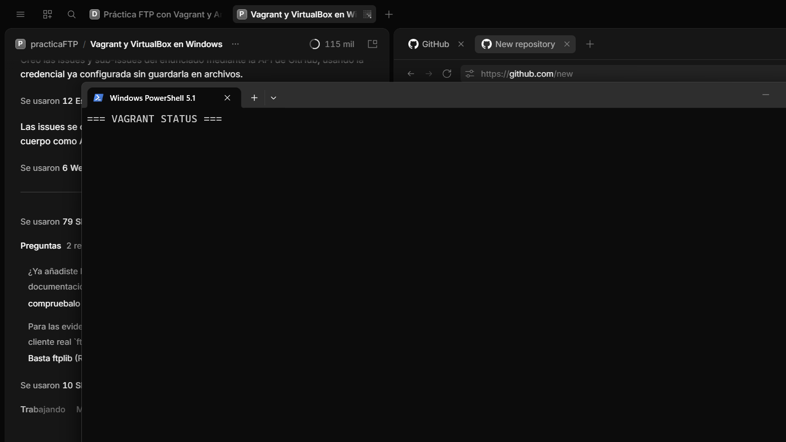

[Ver captura del estado de Vagrant](capturas/20261122_171257-vagrant_status_real.png)

<a id="entorno"></a>

## 4. Comprobaciones iniciales del entorno

Se verificaron las versiones del sistema operativo, PowerShell, Vagrant,
VirtualBox, Git y SSH, además de la ruta del proyecto y el contenido de la
carpeta de trabajo antes de empezar.

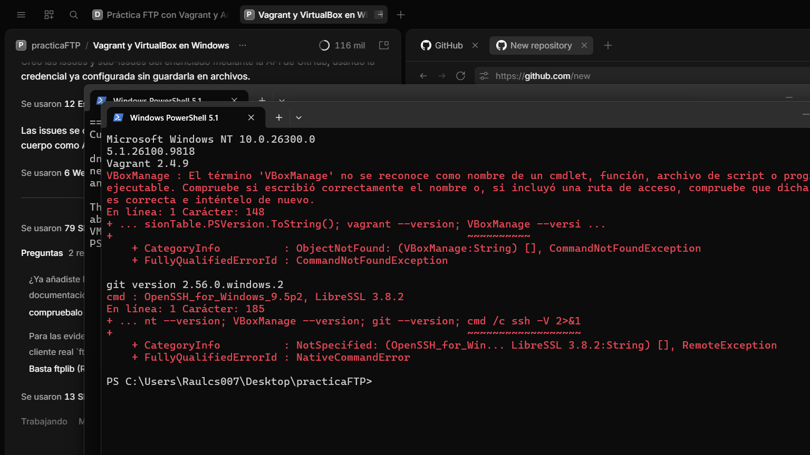

[Ver captura del entorno](capturas/20261122_171322-entorno_comprobaciones.png)

<a id="ansible"></a>

## 5. Nodo de control de Ansible

`ansible.cfg` fija `remote_user = vagrant`, el inventario por defecto, el
intérprete Python automático y `host_key_checking = False` (solo para la
práctica). `inventory.yml` define los alias `dns` y `negocio` con sus IPs y las
claves privadas locales. `requirements.yml` instala `community.crypto`.

En el nodo `ansible` se comprobaron el inventario, el módulo `ping` y la
elevación con `uptime`:

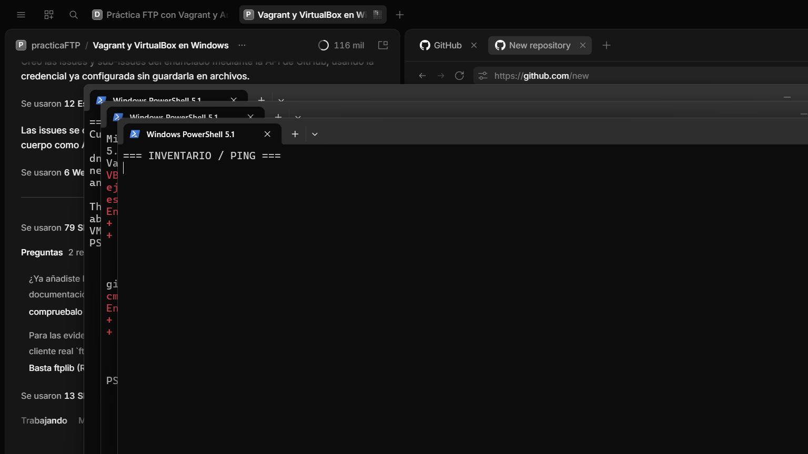

[Ver captura del nodo Ansible](capturas/20261122_171329-ansible_nodo_control.png)

<a id="dns"></a>

## 6. Servidor DNS

`dns/dns.yml` instala BIND9, copia `named.conf.options`, `named.conf.local` y
las dos zonas, valida la configuración con `named-checkconf` y `named-checkzone`,
y reinicia el servicio mediante un *handler* solo cuando cambia algún archivo.
La recursión queda limitada a la red privada `192.168.57.0/24`.

`dns/test-dns.sh` comprueba las resoluciones directas e inversas. Las ocho
consultas terminaron correctamente:

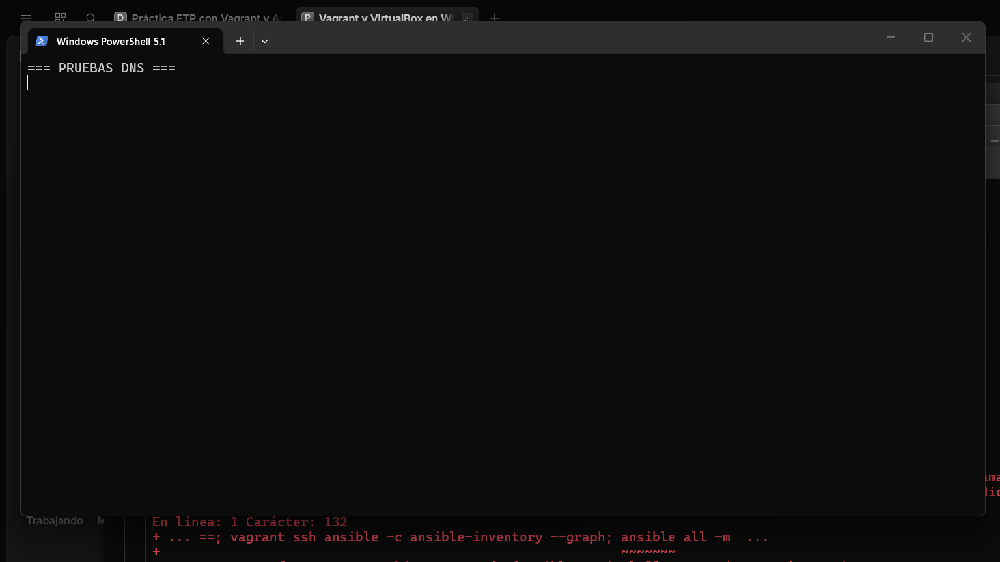

[Ver captura de las pruebas DNS](capturas/20261122_171336-dns_pruebas_registros.png)

<a id="web"></a>

## 7. Servidor web

`web/web.yml` instala Apache2, publica `web/files/index.html` en
`/var/www/html/index.html`, habilita el servicio y usa un *handler* de reinicio.
La página contiene el texto «Servidor web de raul.test», comprobado con
`web/test-web.sh` mediante `curl`.

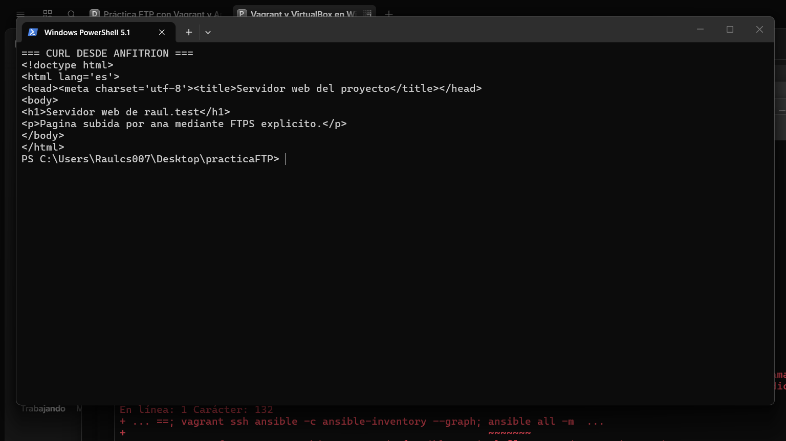

[Ver captura de la prueba web](capturas/20261122_171342-web_prueba_curl.png)

La página también se abrió en un navegador apuntando a `http://www.raul.test/`,
usando el nombre DNS y no la dirección IP:


[Ver captura del navegador](capturas/web_playwright_raul_test.png)

<a id="ftp"></a>

## 8. Servidor FTP seguro

`ftp/ftp.yml` instala `vsftpd` y `python3-cryptography`, crea los grupos
`ftpusers` y `webpublish`, crea los usuarios `juan` y `ana` con los hashes
SHA-512-crypt guardados en `ftp/vars/vault.yml` (cifrado), y deja
`/var/www/html` con grupo `webpublish` y modo `2775`.

`ftp/files/vsftpd.conf` configura el modo independiente solo en IPv4, sin
acceso anónimo, con usuarios locales, `local_umask=002`, chroot por defecto con
excepción para `ana` y FTP explícito sobre TLS obligatorio. El certificado
autofirmado se genera con `community.crypto`, con `CN=ftp.raul.test` y SAN
`DNS:ftp.raul.test`, en `/etc/ssl/raul`.

El servicio activo y el certificado presentado por el servidor:

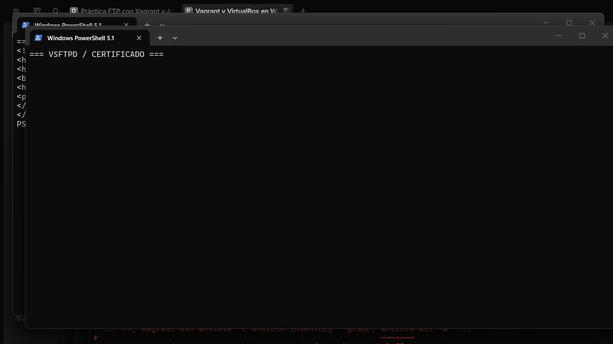

[Ver captura del servicio y certificado](capturas/20261122_171349-ftp_servicio_certificado.png)

Las diez comprobaciones realizadas con `ftplib.FTP_TLS` (acceso de `ana`,
rechazo de `anonymous`, chroot de `juan`, subida y descarga cifradas, etc.)
terminaron correctamente:

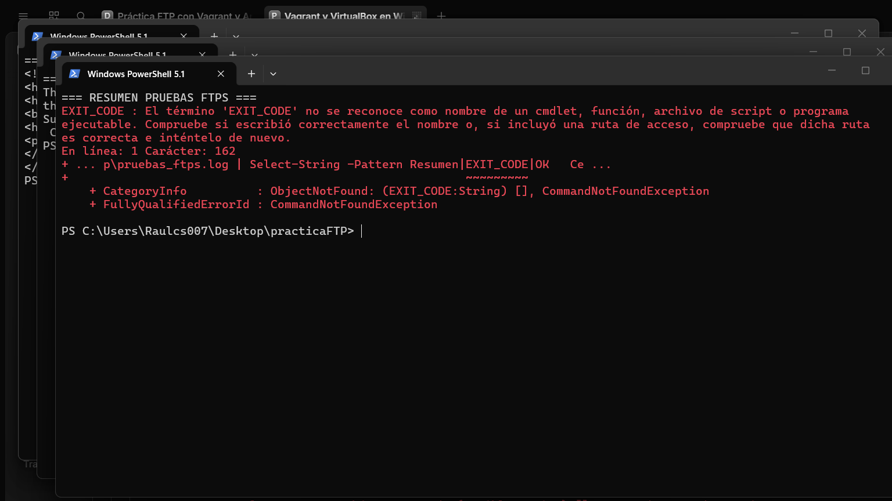

[Ver captura del resumen de pruebas FTP](capturas/20261122_171355-ftp_resumen_pruebas.png)

El detalle de cada prueba y el resultado esperado están en
[`ftp/PRUEBAS.md`](../ftp/PRUEBAS.md).

<a id="github"></a>

## 9. Repositorio, issues y tablero

El repositorio se creó en la cuenta `raulcalvosantos2007-lang` con el nombre
`FTP-RaulCalvoSantos`:

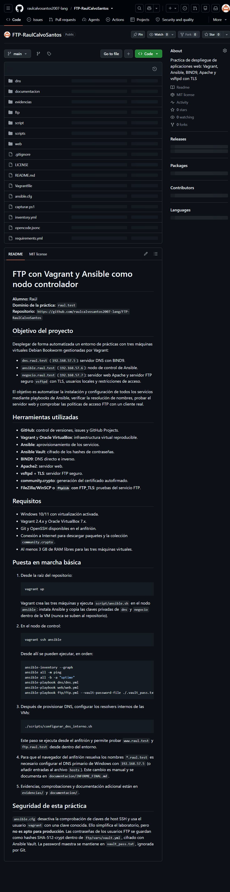

[Ver captura del repositorio](capturas/github_01_repositorio_creado.png)

Se crearon 40 issues asignadas, 33 de ellas como sub-issues de seis issues
principales, y se cerraron una vez comprobado el trabajo:

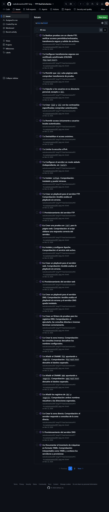

[Ver captura de las issues](capturas/github_03_issues.png)

El proyecto `Practica FTP Vagrant Ansible` se asoció al repositorio con una
vista de tablero con las columnas «Por hacer», «En progreso» y «Hecho»:

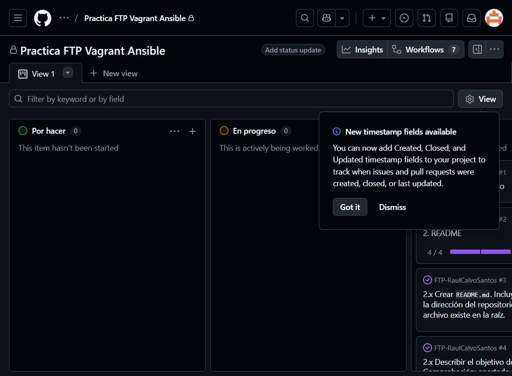

[Ver captura del tablero](capturas/github_02_proyecto_tablero.png)

Las 40 tarjetas quedaron en la columna «Hecho» y el proyecto aparece vinculado
al repositorio:

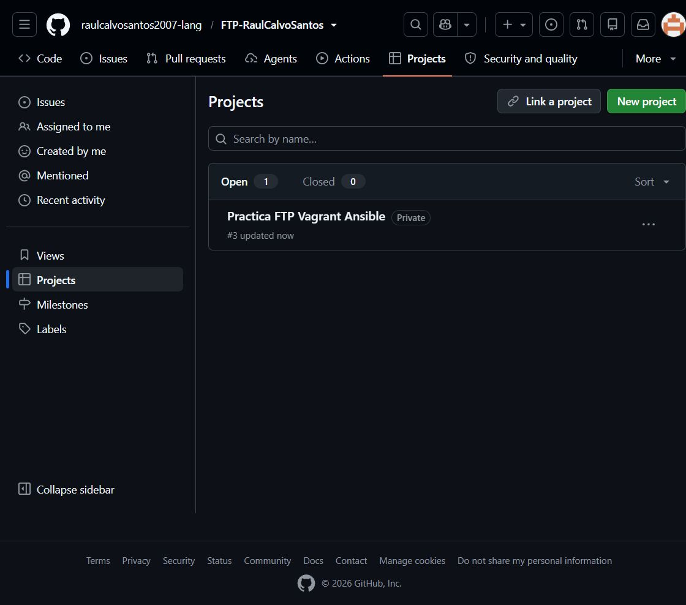

[Ver captura del proyecto vinculado](capturas/github_04_proyecto_vinculado.png)

<a id="resultados"></a>

## 10. Resultado de las comprobaciones

| Bloque | Comprobación | Resultado |
|---|---|---|
| Vagrant | Tres máquinas levantadas | Correcto |
| Ansible | Inventario, `ping` y elevación | Correcto |
| DNS | 8 consultas directas e inversas | 8/8 correctas |
| Web | Respuesta HTTP en `www.raul.test` | `200 OK` |
| FTP | Pruebas con `FTP_TLS` | 10/10 correctas |
| FTP | Acceso anónimo | Rechazado |
| FTP | Chroot de `juan` / publicación de `ana` | Correcto |
| GitHub | Issues cerradas y tablero | 40 en «Hecho» |

## 11. Seguridad

La configuración SSH de esta práctica usa el usuario `vagrant` y una clave
conocida, con `host_key_checking = False`; está pensada solo para el laboratorio.
Las contraseñas FTP nunca se escriben en claro en los playbooks: se guardan como
hashes en `ftp/vars/vault.yml`, cifrado con Ansible Vault. La contraseña maestra
se conserva fuera del repositorio en `vault_pass.txt`, incluido en `.gitignore`.
Las capturas no muestran contraseñas, tokens ni claves privadas.

## 12. Conclusión

El entorno queda definido como código y reproducible: después de clonar el
repositorio basta con ejecutar `vagrant up` y los playbooks en el orden indicado
para obtener los servicios DNS, web y FTP con TLS. Las capturas enlazadas en
esta memoria documentan cada una de las comprobaciones realizadas.
