# Capturas de la práctica

Esta carpeta contiene las **12 capturas reales** obtenidas durante la ejecución
de la práctica. Todas se muestran incrustadas en la
[memoria de la práctica](../MEMORIA.md) y están enlazadas desde el apartado
correspondiente de ese documento, de forma que pueden verse dentro de la
documentación sin salir de ella.

| # | Captura | Apartado en la memoria |
|---|---|---|
| 01 | `20261122_171257-vagrant_status_real.png` | [3. Infraestructura con Vagrant](../MEMORIA.md#vagrant) |
| 02 | `20261122_171322-entorno_comprobaciones.png` | [4. Comprobaciones iniciales](../MEMORIA.md#entorno) |
| 03 | `20261122_171329-ansible_nodo_control.png` | [5. Nodo de control de Ansible](../MEMORIA.md#ansible) |
| 04 | `20261122_171336-dns_pruebas_registros.png` | [6. Servidor DNS](../MEMORIA.md#dns) |
| 05 | `20261122_171342-web_prueba_curl.png` | [7. Servidor web](../MEMORIA.md#web) |
| 06 | `web_playwright_raul_test.png` | [7. Servidor web](../MEMORIA.md#web) |
| 07 | `20261122_171349-ftp_servicio_certificado.png` | [8. Servidor FTP seguro](../MEMORIA.md#ftp) |
| 08 | `20261122_171355-ftp_resumen_pruebas.png` | [8. Servidor FTP seguro](../MEMORIA.md#ftp) |
| 09 | `github_01_repositorio_creado.png` | [9. Repositorio, issues y tablero](../MEMORIA.md#github) |
| 10 | `github_02_proyecto_tablero.png` | [9. Repositorio, issues y tablero](../MEMORIA.md#github) |
| 11 | `github_03_issues.png` | [9. Repositorio, issues y tablero](../MEMORIA.md#github) |
| 12 | `github_04_proyecto_vinculado.png` | [9. Repositorio, issues y tablero](../MEMORIA.md#github) |

## 01. Estado de las máquinas

`vagrant status` después de `vagrant up`: `dns`, `negocio` y `ansible` en estado
`running`.

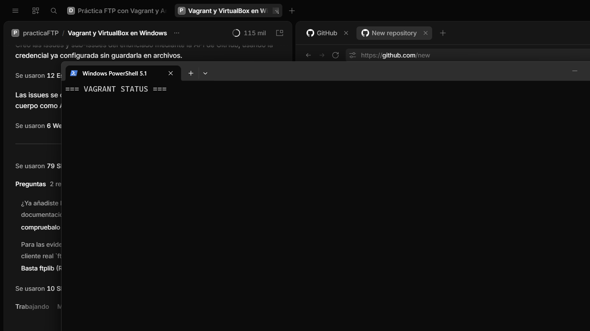

## 02. Comprobaciones del entorno

Versiones del sistema operativo, PowerShell, Vagrant, VirtualBox, Git y SSH.

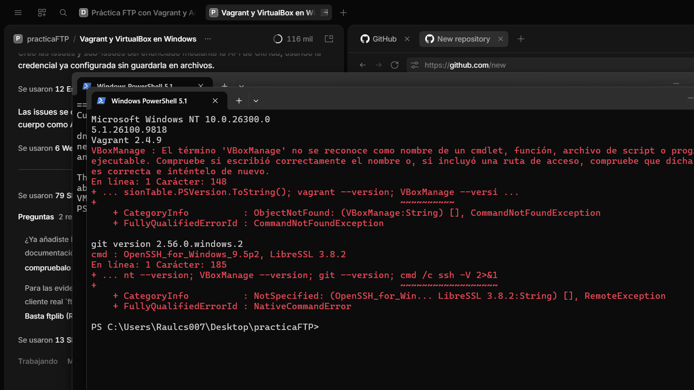

## 03. Nodo de control de Ansible

Inventario, conectividad con `ping` y elevación desde la máquina `ansible`.

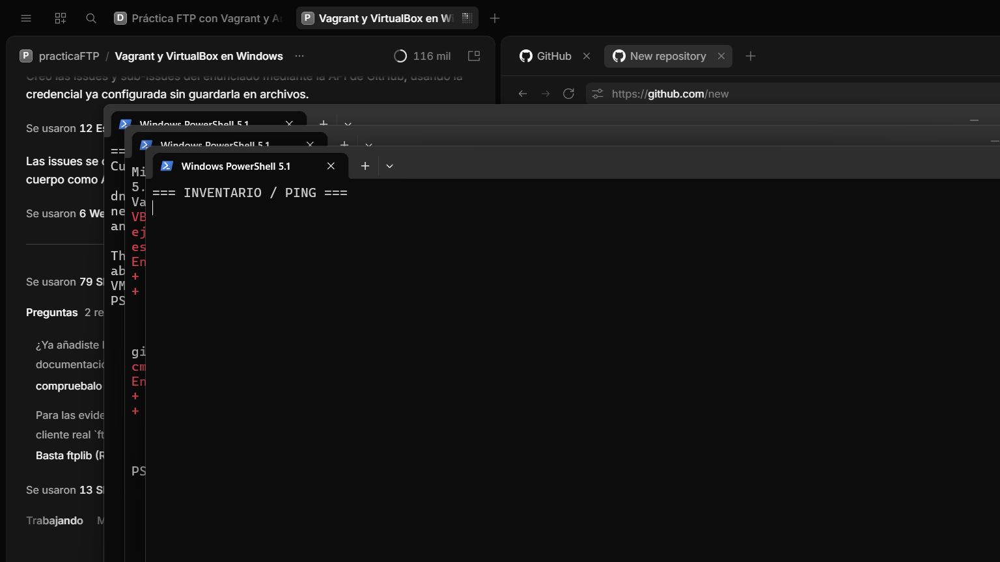

## 04. Resolución DNS

Salida de `dns/test-dns.sh`: ocho consultas directas e inversas correctas.

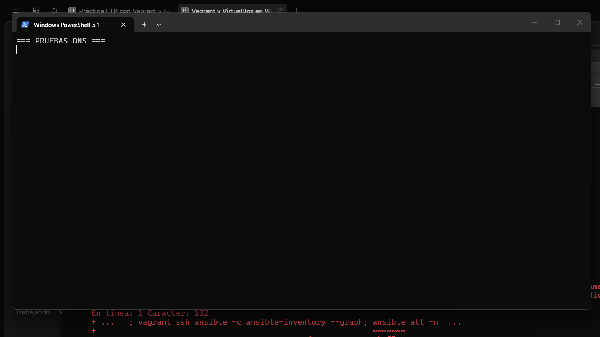

## 05. Servidor web

Respuesta HTTP comprobada con `web/test-web.sh`.

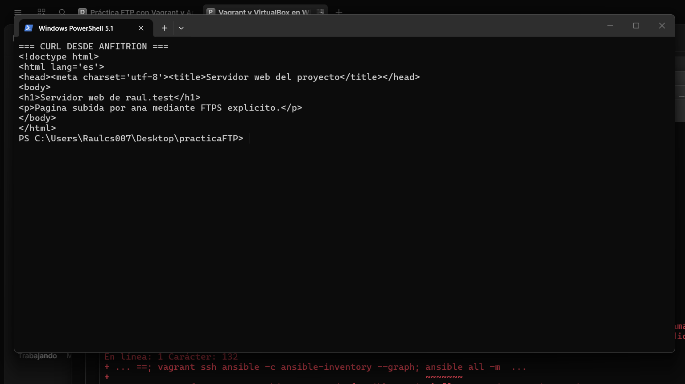

## 06. Navegador en `www.raul.test`

Página servida por Apache accediendo por nombre DNS, no por IP.

## 07. Servicio y certificado FTP

Servicio `vsftpd` activo y certificado con `CN=ftp.raul.test`.

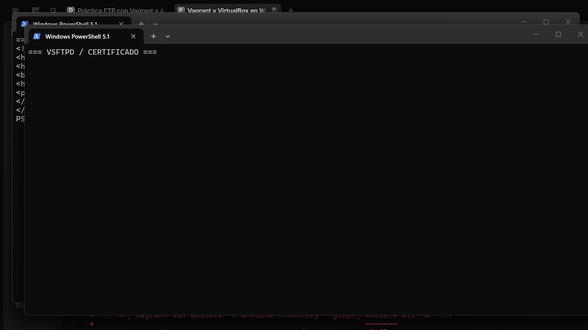

## 08. Resumen de pruebas FTPS

Diez comprobaciones con `ftplib.FTP_TLS`: accesos, rechazo anónimo, chroot y
subida cifrada.

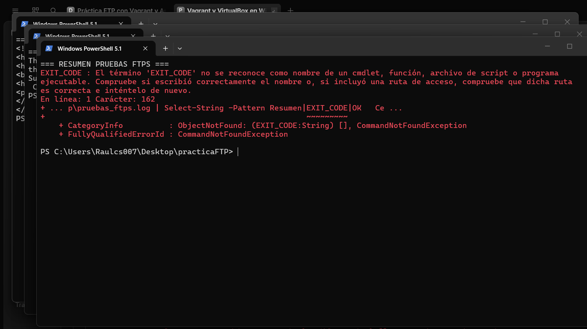

## 09. Repositorio creado

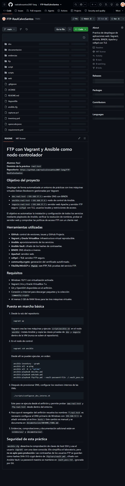

## 10. Tablero del proyecto

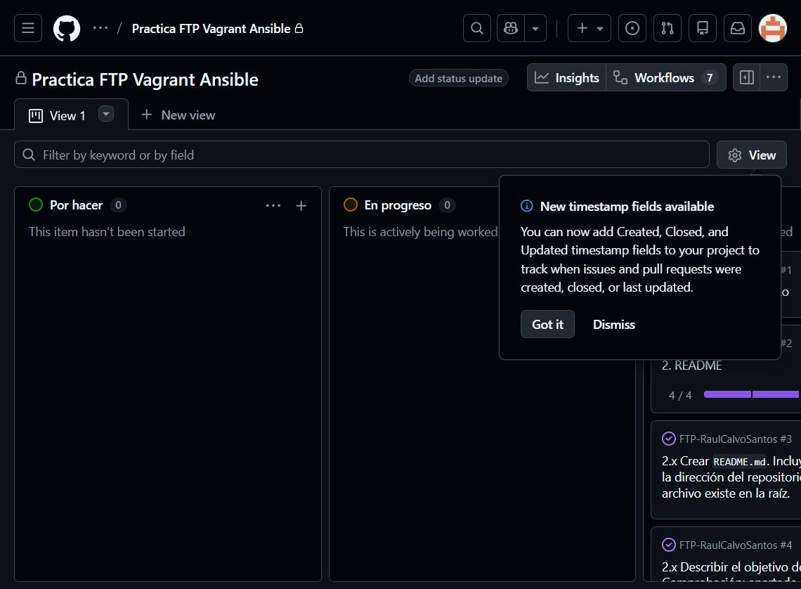

## 11. Issues

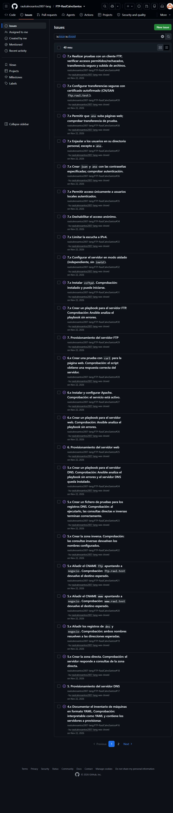

## 12. Proyecto vinculado

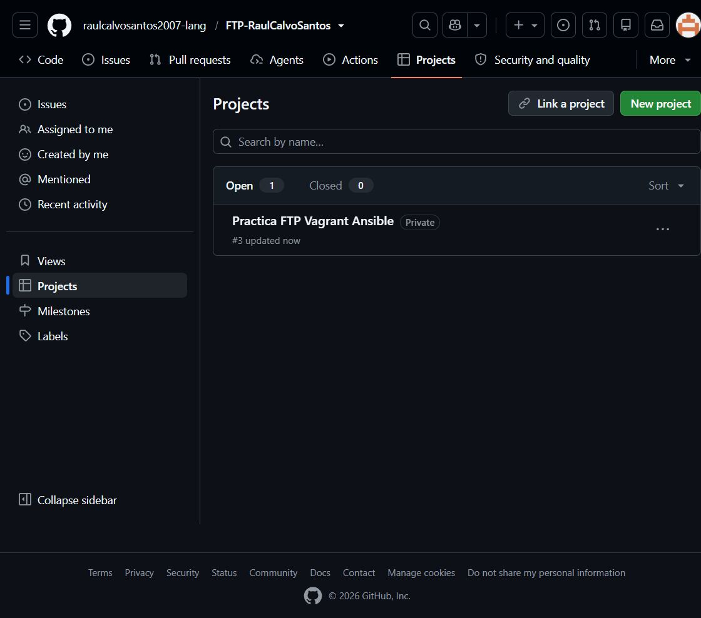

## Cómo obtenerlas

- Las imágenes 01 a 08 son capturas reales de ventanas de terminal con la salida
  de los comandos ejecutados en el entorno.
- La imagen 06 se tomó con un navegador controlado apuntando a
  `http://www.raul.test/`.
- Las imágenes 09 a 12 son capturas reales de la interfaz de GitHub.
- Ninguna imagen muestra contraseñas, tokens ni claves privadas.

Volver a la [memoria de la práctica](../MEMORIA.md).
